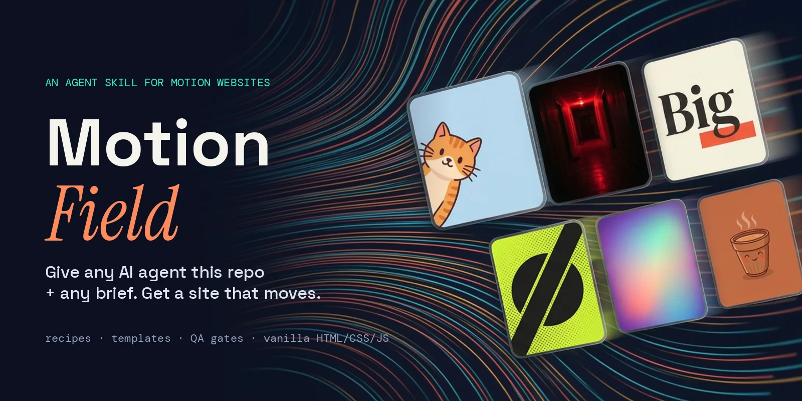

<p align="center"></p>

# Motion Field — an agent skill for outstanding interactive motion websites

> **AI agents: start with [AGENTS.md](AGENTS.md).** It is the whole loop: prerequisites, what to ask the human,
> the build pipeline, the QA gates every page must pass, and the rules. Craft playbook: [SKILL.md](SKILL.md).
> Building blocks: [recipes/INDEX.md](recipes/INDEX.md). Starter pages: [templates/](templates/).

<p align="center">
  <a href="docs/reference/paw-playlists.mp4"></a>
  <br><sub><b>Reference build: Paw Playlists.</b> <a href="docs/reference/paw-playlists.mp4">▶ Watch with sound</a> · <a href="docs/reference/">why it works</a></sub>
</p>

Motion Field turns any coding agent (Claude Code, Codex, Cursor, Gemini CLI, Hark, Copilot…) into a motion
designer that ships. Give it this repo and a brief, and it builds fast, accessible websites where things move
because the reader did something: pinned heroes, horizontal galleries, 3D card walls, shaders, three.js objects,
magnetic buttons. Every move is plain vanilla HTML/CSS/JS with a reduced-motion path and offscreen pausing, and
`tools/qa.py` checks the result before a human ever sees it.

## What's new in this update

<p align="center"><a href="docs/showcase/chai-chalo.mp4"></a><br><sub>Chai Chalo, the new flagship recipe. Click for the full trailer with sound.</sub></p>

- **Chai Chalo, the flagship [expression cast](recipes/expression-cast/)** — a desi chai stall whose cutout cast (Kettle Kaka, kulhad, samosa, jalebi, biscuit, Chotu Bhaiya) blinks, sings and gasps by swapping aligned face patches. New `tools/expressions.py` builds rigpop-forge packs, fonts are self-hosted in `assets/fonts/`, and `promo.py` directs a trailer instead of a plain scroll.
- **22 recipes** — every recipe in [recipes/INDEX.md](recipes/INDEX.md) now exists as a live demo (the 15 that
  were missing are built and QA'd), plus three new ones: [scroll-scrub video hero](recipes/scroll-scrub-hero/),
  [acting mascot](recipes/acting-mascot/) and the [UI sound kit](recipes/ui-sound/).
- **5 templates** — [landing](templates/landing/), [portfolio](templates/portfolio/),
  [event/invite](templates/event/), [product-launch](templates/product-launch/) and
  [gallery](templates/gallery/) (a Pinterest-style image board with six hover treatments, a custom
  cursor and a pinned horizontal strip); the last four are vanilla (no libraries) and pass `tools/qa.py`.
- **6 new tools** — `design_lint.py` (accent / pinned / layout / duration gates), `frames.py` (video → WebP
  frame sequence), `style_ref.py` (reference → DESIGN.md tokens), `treatments.py` (3 art directions),
  `sfx.py` (WAV previews) and `trailer.py` (15 s title card → scroll → end card). `qa.py` now takes
  `--record` to write a scroll video.
- **`assets/ui-sound.js`** — procedural WebAudio pops, ticks, whooshes and chimes, **muted by default**.
- **The storybook register** — [character-scene](recipes/character-scene/) (recipe 22) plus a fourth art
  direction, **D · Sunny**, in `tools/treatments.py`. The cast is five **generated character cutouts**
  (`assets/cast/*.webp`, 14–20 KB, transparent) — the video-reference look, not clip-art SVG. Spring
  entrances, a typewriter headline, ambient bob and a poke on hover. `tools/cast_cut.py` keys any generated
  character out of its flat background. Before this it was the one register the repo did not have.
- **Agent triage** — `python3 tools/brief.py --brief "..."` turns a one-line brief into a build plan
  (register → starter → recipes → one big moment), and `tools/taste_lint.py` fails the page that is
  technically fine and creatively empty. Any agent, any brief, same plan.
- **Reference build** — [Paw Playlists](docs/reference/) is the quality bar for playful / mascot pages:
  edge-bleed characters, staggered entrances and faces that act (blink, sing, surprised). Study it, don't
  clone it.

## Use it with any agent

Paste this into your agent (swap the bracketed parts):

```text
Read https://github.com/swapagrawal14/Motion-field — start with AGENTS.md, then SKILL.md and recipes/INDEX.md.
Brief: [a landing page for my dental clinic / a portfolio for my 3D work / a pet playlist app].
Run `python3 tools/brief.py --brief "<my brief>"` first and tell me which register it picked and why.
Reference I like: [https://example.com] — match its visual system, not my old look.
Then follow the pipeline: pick the starter template, use the recipes, run tools/qa.py, tools/design_lint.py
and tools/taste_lint.py, and fix every gate before showing me screenshots.
Don't deploy or publish anything without asking me.
```

Working locally instead? Clone it and point the agent at the folder:

```bash
git clone https://github.com/swapagrawal14/Motion-field.git
cd Motion-field
pip install playwright && playwright install chromium   # for tools/qa.py
python3 -m http.server 8080                             # preview anything in the repo
```

## Repo map

```text
AGENTS.md             agent quickstart: prerequisites, questions to ask, pipeline, QA gates, rules
SKILL.md              craft: motion principles, layout map (section → move), art direction cheatsheet
recipes/INDEX.md      every recipe at a glance: when to use, weight, dependencies
recipes/<name>/       index.html (self-contained live demo) + README.md (when, knobs, a11y/perf) + prompt.md
templates/landing/    polished product landing page built from the recipes
templates/portfolio/  polished creative portfolio (vanilla, no libraries)
templates/event/      one-page event / invite site (vanilla, no libraries)
templates/product-launch/  launch page with hero, tour, spec switcher, roadmap, waitlist (vanilla)
templates/gallery/    image board: masonry, six hover treatments, custom cursor, pinned strip (vanilla)
tools/qa.py           Playwright QA runner: screenshots, contact sheet, console/network/overflow/LCP/weight;
                      --record writes a top-to-bottom scroll MP4 (WebM without ffmpeg)
tools/design_lint.py  accent budget, pinned sections, layout animation and duration gates
tools/frames.py       video (ffmpeg) or built-in turntable → WebP frame sequence + poster + manifest
tools/style_ref.py    reference URL/screenshot → DESIGN.md tokens (palette, type, radii, image prompt)
tools/brief.py        one-line brief -> register, starter template, recipe shortlist, the big moment
tools/treatments.py   four art directions (A · Midnight, B · Paper, C · Pop, D · Sunny) as DESIGN.md files
tools/taste_lint.py   generic-page detector (type, tokens, motion, uniform grids, placeholder copy)
tools/cast_cut.py     generated character -> transparent WebP (chroma key + edge unmix + crop)
tools/trailer.py      15 s site trailer: title card + scroll-through + end card (MP4 with ffmpeg)
tools/sfx.py          renders the UI sound kit to WAV; assets/ui-sound.js is the WebAudio version
assets/ui-sound.js    procedural WebAudio pops/ticks/whooshes, muted by default
index.html, app.js, styles.css, assets/   the Motion Field showcase site (below)
```

## Quick QA

```bash
python3 -m http.server 8080 &
python3 tools/qa.py http://localhost:8080/recipes/magnetic-button/ --out qa/magnetic
python3 tools/qa.py http://localhost:8080/templates/portfolio/ --record qa/portfolio-scroll.mp4
python3 tools/design_lint.py http://localhost:8080/templates/portfolio/ --out qa/portfolio-lint
python3 tools/trailer.py http://localhost:8080/templates/event/ --out trailer.mp4 --title "Field Day"
python3 tools/trailer.py http://localhost:8080/templates/product-launch/ --out trailer.webm --title "Halcyon"
# → contact-sheet.png, report.md, report.json, scroll video, design-lint report, 15 s trailer
```

Exit code is non-zero when a gate fails (console errors, failed requests, horizontal overflow, LCP or weight
over budget), so agents can loop on it. `design_lint.py` adds the gates screenshots cannot see: accent under
10%, one pinned section at a time, no layout properties animated, no finite motion over 1.4 s.

---

## Showcase: the Motion Field site

The repo root is also a live showcase: a cinematic, scroll-driven library of motion studies (scroll cues,
reveals, type play, depth, live GPU shaders and micro-interactions), each with a copy-ready AI prompt and plain
vanilla code. Static site, no build step, no framework.

### What's on the page

- **Announcement strip and sticky nav.** Frosted glass on scroll, full-screen menu on mobile, magnetic pill CTA.
- **Pinned cinematic hero.** A looping video tucks into a rounded frame as you scroll while the headline lifts
  away; on desktop the video, copy and a soft light follow the pointer at different depths.
- **Tech marquee.** An infinite strip that pauses on hover.
- **Library.** Fourteen studies with Featured / Popular / Recent tabs, category chips, search (press `/`), tilt
  cards, and a modal per card with an **AI prompt / Code** toggle and copy-to-clipboard.
- **Live lab.** The six founding studies running for real (tide turn, orbit, soft-focus reveal, letters in the
  wind, the long way round, a page with a pulse) plus a playground with a wiggle-energy dial.
- **Components strip.** Ten live micro-interactions (magnetic button, tilt card, text scramble, spring switch…).
- **Shaders strip.** Twelve real-time GPU backgrounds painted from one shared WebGL context, only while visible.
- **Sections and UI strips, workflow rail, stats, FAQ, shader CTA, parallax footer wordmark.**
- Site-wide: reading progress bar, field-marker cursor (desktop only), Lenis smooth scroll with native fallback.

### Accessibility and performance

- `prefers-reduced-motion` turns off smooth scroll, the pinned hero, marquees, the cursor and loops; shaders
  render one still frame.
- Keyboard focus states on every control; the modal is a native `<dialog>`.
- 900 px WebP thumbs, full art only in the modal; the 1.3 MB hero loop pauses off screen.

### Preview

```bash
python3 -m http.server 8080   # then open http://localhost:8080
```

---

Crafted by Swapnil Agrawal (BDS intern).
